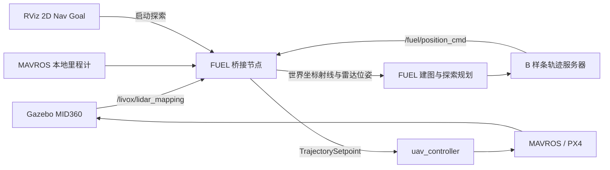

# P600 / MID360 / FUEL 仿真问题与解决记录

记录日期：2026-09-17；2026-09-18 按 `refactor/fuel` 更新目录、构建及控制状态说明。适用于本工程的 ROS Noetic、Gazebo、P600、MID360 和完整 FUEL 接入。

本文整理接入过程中实际遇到的报错、定位依据、修改位置和验证结果。日常使用说明见 [FUEL README](../src/fuel_bridge/README.md)。**当前分支已通过短程 Gazebo/PX4 飞行检查，整场探索覆盖和长期边界行为仍需验收；本次结果见 [重构记录](REFACTOR.md)。**

## 1. 当前系统与控制链路

FUEL 负责前沿搜索、探索目标选择和轨迹规划；Gazebo、PX4、MAVROS、定位与无人机控制复用原工程。



### 构建方式的变化

旧工程包含 EGO/FUEL 同名包，所以曾采用独立工作空间和下载后打补丁。`refactor/fuel` 已删除 EGO 等无关模块，改为一个 Catkin 工作空间。完整上游源码位于 [third_party/FUEL](../third_party/FUEL)，原有修复已合入源码；构建不再下载或打补丁。版本及修改记录见 [来源说明](../third_party/FUEL/LOCAL_CHANGES.md)。

[compile_fuel.sh](../compile_fuel.sh) 构建 `src/`，输出 `build/fuel`、`devel/fuel`；[source.sh](../source.sh) 为 Gazebo、控制器、FUEL 和 RViz 加载同一环境。消息使用本工程保留的定义，避免 `PositionCommand` 的 MD5 改变。

### 现在使用什么控制器

当前使用 `src/uav_controller` 的 `ros1` 分支。FUEL 桥接把 `/fuel/position_cmd` 直接转换为 `/uav_controller/trajectory_setpoint`，控制器按位置、速度反馈及加速度前馈计算姿态和推力，并通过 `/uav1/mavros/setpoint_raw/attitude` 发送给 PX4。

FUEL 专用配置 [uav_controller_p600.yaml](../src/fuel_bridge/config/uav_controller_p600.yaml) 启用 `fsm/direct_trajectory`，使用 P600 增益 `k_pos=[8,8,12]`、`k_vel=[4,4,5]` 和悬停油门 `0.258`。空中切入 OFFBOARD 后先锁定当前位置；FUEL 轨迹到达后开始跟踪；停止或超时后回到固定点悬停。

状态接口为 `/uav_controller/fsm_status`，定位直接使用 `/uav1/mavros/local_position/odom`。旧 `prometheus_uav_control`、`UAVCommand` 控制链和独立状态适配器已删除。

## 2. OctoMap 节点无法启动

**现象**：运行原 `base_simulation.sh` 时出现：

```text
ERROR: cannot launch node of type [octomap_server/octomap_server_node]: octomap_server
```

**原因与处理**：ROS 找不到 `octomap_server` 包或其中的可执行节点。先检查依赖和环境；Noetic 中需要安装服务器包，仅安装 `octomap` 或 `octomap_msgs` 不包含该节点。

```bash
sudo apt-get update
sudo apt-get install ros-noetic-octomap-server
source /opt/ros/noetic/setup.bash
rospack find octomap_server
```

以上为旧入口的历史问题。当前分支已删除 `base_simulation.sh` 和 OctoMap 启动配置；`fuel_simulation.sh` 使用 FUEL 自带占据地图与 ESDF，无需安装 OctoMap。

## 3. 启动后出现两个 RViz

**原因**：原 P600 仿真 launch 启动一个 RViz，FUEL launch 又启动一个。

**修复**：旧版本通过 `rviz_enable` 关闭重复窗口。当前 [P600 仿真 launch](../src/gazebo_simulator/launch/p600_mid360.launch) 只启动仿真和 MAVROS，[fuel.launch](../src/fuel_bridge/launch/fuel.launch) 统一启动唯一的 RViz。可用参数关闭：

```bash
bash fuel_simulation.sh rviz:=false
```

## 4. 点云不显示，提示坐标系不匹配

**原报错**：

```text
FUEL requires cloud frame lidar_link and odometry frame world
```

**原因**：实际点云坐标系是 `uav1/lidar_link`，早期桥接配置期望 `lidar_link`。同时需要核对实际加载模型的外参，不能套用另一个 PX4 模型的雷达位置。

**修复**：

- [bridge.yaml](../src/fuel_bridge/config/bridge.yaml) 与 launch 默认使用 `uav1/lidar_link`；里程计使用 `world`。
- 根据实际加载的 [p600_mid360.sdf.jinja](../src/gazebo_simulator/gazebo_models/uav_models/p600_mid360/p600_mid360.sdf.jinja) 计算雷达外参。
- 用同步里程计将局部雷达点转换为世界坐标，并向 FUEL 同步发布雷达射线原点。
- 拒绝非有限点、近距离点、过期输入及不匹配的坐标系；错误日志同时打印实际值和期望值。

模型中雷达安装位置为 `(0.13, 0, 0.23)` m，俯仰角为 `0.35 rad`；传感器自身还有沿局部 z 轴 `0.05 m` 的偏移，因此最终射线原点为：

```text
x = 0.13 + 0.05 × sin(0.35) = 0.1471448904 m
y = 0
z = 0.23 + 0.05 × cos(0.35) = 0.2769686356 m
```

点云与里程计允许的同步时间差为 50 ms。当前默认建图输入已改成 `/livox/lidar_mapping`，该话题的 frame 仍为 `uav1/lidar_link`。

```bash
rostopic echo -n 1 /livox/lidar_mapping/header
rostopic echo -n 1 /uav1/mavros/local_position/odom/header
rostopic hz /fuel/cloud_world
```

不要为了消除报错，直接把原始点云的 `frame_id` 改成 `world`；坐标数值仍需经过外参和里程计变换。

## 5. Frontiers 显示红色 Error

**具体错误**：

```text
Points should not be empty for specified marker type.
```

**原因**：FUEL 清理旧前沿时，在发送删除 Marker 后，又发送了一个点列表为空的 `CUBE_LIST` 或 `SPHERE_LIST` 添加消息，RViz 将其判为无效。

**修复**：修改上游 `PlanningVisualization::drawCubes()` 和 `drawSpheres()`：先删除旧 Marker，若点列表为空就直接返回，不再发送空的 `ADD`。修改记录在 [FUEL 修改记录](../third_party/FUEL/LOCAL_CHANGES.md) 中。

规划链路测试已检查所有前沿 `ADD` Marker 的点列表非空。该问题属于可视化消息错误，不能仅凭红色状态判断规划器没有地图。

## 6. RViz 中不再显示旧 hummingbird Marker

旧无人机示意模型由 `prometheus_uav_control` 状态适配器发布。替换为新控制器后，该旧包和 mesh Marker 一并删除；FUEL 的点云、轨迹、里程计和探索边界显示不受影响。若需要机体外观，应从 Gazebo 模型另行发布可视化 Marker。

## 7. 探索范围与 Gazebo 圆柱场不一致

**原因**：Gazebo 场景坐标与 PX4/Prometheus 的局部定位原点不同。默认出生位置是 Gazebo `(-10, 0)`；局部定位原点在出生点附近。虽然消息都可能使用名称 `world`，不能直接把两种坐标数值混用。

**修复**：按 `planning_easy2.world` 的圆柱场及西侧起飞入口设置探索边界，并换算成局部定位坐标。

| 范围 | x / m | y / m |
| --- | --- | --- |
| Gazebo 场景中的任务范围 | `[-11, 12]` | `[-11, 10]` |
| 默认出生点对应的局部范围 | `[-1, 22]` | `[-11, 10]` |

局部高度范围为 `[0.5, 2.5]` m，地图分配尺寸为 `48 × 32 × 6` m。当前场景近似满足 `x_local = x_gazebo + 10`，实际定位会有少量估计误差。

[simulation.launch](../src/fuel_bridge/launch/simulation.launch) 根据 `spawn_x/spawn_y` 换算默认边界，桥接节点发布黄色边界框 `/fuel/exploration_bounds`。启动时当前位置仍需在框内，但运行中的轨迹指令不再由桥接节点做边界拦截。边界包含西侧入口，因此并非紧贴圆柱外缘的轮廓。

原始回波中出现框外物体是传感器正常观测，不代表 FUEL 在选择框外目标。应结合黄色框、前沿和规划轨迹判断。

## 8. 用 RViz 2D Nav Goal 触发探索

原代码已订阅目标话题，但启动日志仍提示调用服务，点击失败时提示也不够明确。

**处理**：保留并验证 `rviz/SetGoal → /move_base_simple/goal → 桥接节点 → FUEL` 的链路；启动日志改为提示使用 RViz，失败改为警告并打印原因，RViz 增加 `Tool Properties` 便于检查话题。

操作顺序为：点击 **2D Nav Goal**，在地图上按住左键拖出方向箭头，再松开。单纯选中工具不会发送目标。

点击位置仅用于启动探索，**不是指定无人机必须飞到该位置**。桥接节点用当前里程计位置构造触发消息，目标由 FUEL 选择。

启动前必须满足：

- 定位、点云和控制状态足够新，控制器状态为 `HOLD` 或 `TRAJECTORY`、`feedback_ready=true` 且输出策略为 `CLOSED_LOOP`。
- 无人机当前位置处于探索框内；启动不再限制当前高度和速度。
- FUEL 已订阅建图输入和触发话题。

不满足时会看到 `RViz 2D Nav Goal did not start exploration: ...`。满足条件后重新点击即可。测试已验证无需调用启动服务也能触发，重复点击不会重启正在进行的探索。

`WAIT_TRIGGER` / `wait for trigger` 是等待启动的正常状态。命令行 `/fuel/start` 仍作为备用入口保留。

## 9. 边界附近反复绕圈、轨迹不进入中心

这一现象涉及三个不同问题，不能用单次调参概括。最近一次排查日志后期一直剩下 4 个前沿，并反复出现 `Replan: traj fully executed`，说明规划器还在持续生成短轨迹；仅凭这些日志不能确认所有绕圈都只有一个原因。

### 9.1 框外未知区域造成假前沿

原 FUEL 检查候选前沿栅格在框内，却没有要求其未知邻居也在框内。结果是：框内已经观测完成，框外未知区域仍使边缘保持“值得探索”的状态。

**修复**：未知邻居必须在探索框内；种子搜索排除框上界外的栅格；访问邻居索引前先检查范围。涉及上游 `FrontierFinder::searchFrontiers()`、`expandFrontier()` 和 `isNeighborUnknown()`。

回归测试在修改前复现了“框内全部自由，仍残留前沿”；修改后通过，同时验证框内真实未知区域仍会产生前沿，并在观测完成后移除。

### 9.2 无回波射线被丢弃，扫过的空地仍是未知

原雷达插件将没有碰到物体的射线输出为 `(0, 0, 0)`。桥接节点正确地过滤了零点，但射线方向已经丢失，FUEL 无法据此把空地更新成自由空间。上一轮边界修复不能解决这种框内未知残留。

**修复**：

- [雷达插件](../src/livox_laser_gazebo_plugins/src/livox_points_plugin.cpp) 新增可选 `mapping_topic`，模型配置为 `/livox/lidar_mapping`。
- 该话题保留真实回波，并把无命中射线表示为沿原方向的 40 m 端点；无效、过近的返回不会作为清空射线。
- FUEL 默认订阅新话题。其建图射线长度为 10 m，超出范围的端点被截断，只更新自由空间，不将截断端点当成障碍物。
- RViz 改用 `/fuel/cloud_hits_world` 显示真实回波，避免把 40 m 无回波端点显示为障碍物；`/fuel/cloud_world` 用于建图。

原 `/livox/lidar` 的输出语义保持不变。`bridge.yaml` 的 `no_return_range: 40.0` 用于显示过滤，必须与模型最大量程一致；建图量程应小于这一最大量程。

无界面 Gazebo 墙面测试通过：当次一帧保留了 8,331 条无回波方向和 1,650 个真实墙面回波，两个话题的时间戳和 frame 一致。这个数量是单次样本，不是每帧固定值。SDF 地图测试确认远端射线可以清除有限范围自由空间，且不会创建假障碍物。

**插件和模型修改必须重启整个 Gazebo 后才生效，只重启 FUEL 或 RViz 不够。**

### 9.3 观察点可见性使用了错误的射线原点

之前建图已经使用真实雷达位置，但候选观察点的视场和遮挡判断仍从机体中心计算。雷达高出机体约 0.277 m，下视角有限，机体中心“能看见”的低处栅格，实际雷达可能看不见。

**修复**：在 [mid360.yaml](../src/fuel_bridge/config/mid360.yaml) 增加与桥接一致的雷达平移外参；上游 `PerceptionUtils` 计算实际传感器位置；前沿可见性、遮挡射线及视场显示均使用该位置。

外参测试已验证偏航旋转后的雷达位置，以及“机体高度附近的栅格实际落在雷达下视场外”的情况。

### 9.4 不飞进中心是否一定异常

FUEL 的任务是观测未知空间，不要求机体飞过每个网格。中心若已被周围扫描覆盖，可以不飞进去；如果目标是逐行覆盖或巡检每处位置，需要另行设计覆盖任务。

当前 RViz 的 `Travel` 来自轨迹服务器发布的历史命令位置（`traj_cmd_`），不是实际里程计轨迹。判断飞机实际是否绕圈或跟踪偏离，应结合 `/uav1/mavros/local_position/odom`，不能只看蓝色历史命令线。

另一方面，仅看到中心的圆柱点云，不等于周围自由空间全部已知。应区分：目标持续改变但地图有进展、目标长期残留且地图无进展，以及规划轨迹正常但实际飞机跟踪偏离。第三种情况要检查控制跟踪，不能靠前沿参数解决。

上述三项修复已编译并通过对应测试。完整 P600 自动探索复验因检测到已有 PX4 实例而未启动，尚无“原截图中的循环已经完全消失”的闭环验证结论。

## 10. 参数应该怎样调整

先确认新插件、新话题和外参已经生效，再逐项调整 [mid360.yaml](../src/fuel_bridge/config/mid360.yaml)。以下试调值没有写入当前默认配置。

| 参数 | 当前值 | 可试值 | 适用条件与代价 |
| --- | --- | --- | --- |
| `frontier/cluster_min` | 30 | 50 | 过滤零散小簇，但会忽略部分小型未知区域 |
| `frontier/min_visib_num` | 10 | 15 | 减少收益较低的观察点，但可能使部分前沿没有可用观察点 |
| `frontier/min_view_finish_fraction` | 0.2，上游默认 | 0.4 | 仅在大量 `Replan: cluster covered` 时尝试，减少小幅变化触发重规划 |
| `fsm/thresh_replan3` | 1.5 s，上游默认 | 2.5 s | 仅在定期重规划过于频繁时尝试，会降低目标更新频率 |

`min_view_finish_fraction` 不是任务完成覆盖率。放大边界、提高速度或同时修改多个阈值，都不能证明建图问题已经解决。`bridge.yaml` 主要管理输入外参、滤波、触发与超时；前沿参数应放在 `mid360.yaml`。

## 11. 探索完成后停在哪里

FUEL 在没有可继续访问的前沿时进入 `FINISH`，打印 `finish exploration.`。正常已有轨迹时，轨迹服务器结束当前有效轨迹段后，持续发布该段停止点的位置和朝向，并将期望速度、加速度、偏航角速度设为零，由控制器维持位置。

因此当前行为是**在最后有效轨迹段的停止点附近悬停，不自动返航或降落**。该停止点不一定是最初完整轨迹的终点，因为重规划会截短当前轨迹。

“完成”表示没有可探索的前沿，并不保证框内所有体素都已被观测；遮挡、传感器盲区、不可达区域仍可能留下未知空间。完成机制已通过代码核对，未进行完整闭环完成过程的验收。

手动调用 `/fuel/stop` 会停止轨迹转发并请求当前位置悬停；它与正常 `FINISH` 的轨迹末端保持是不同的处理路径。需要重新触发时，可先停止，再待稳定后点击 2D Nav Goal。

## 12. 当前推荐启动顺序

以下命令均从工程根目录执行，默认无人机为 `uav1`，仅用于本仿真。

### 编译更新

依赖安装和外部 PX4 准备见 [项目 README](../README.md)。整套工程只需一次构建：

```bash
bash compile_fuel.sh
```

| 修改内容 | 编译与重启要求 |
| --- | --- |
| 环境脚本、launch、RViz 配置 | 通常无需编译；重启对应启动流程 |
| `bridge.yaml`、`mid360.yaml` | 无需编译；重启 FUEL 以重新读取参数 |
| 桥接 C++、FUEL 源码 | 运行 `bash compile_fuel.sh`，重启 FUEL |
| 雷达插件 C++ | 运行 `bash compile_fuel.sh`，重启整个 Gazebo |
| 模型 Jinja 的传感器配置 | 重新生成并加载模型；本项目通过重启整个仿真实现 |

### 启动、起飞和触发

终端一，关闭旧仿真后启动整套 FUEL 仿真：

```bash
cd ~/prometheussuperp600gazebo
bash fuel_simulation.sh
```

等待 PX4 连接、点云和地图出现。FUEL 应在起飞前运行，以记录起飞过程中扫描到的自由空间。

在 QGroundControl 中解锁并手动起飞到约 1.2 m，稳定后切换到 OFFBOARD。终端中可确认：

```bash
source source.sh
rostopic echo -n 1 /uav1/mavros/state
rostopic echo -n 1 /uav_controller/fsm_status
```

控制器进入 `HOLD` 且输出策略为 `CLOSED_LOOP` 后，在 RViz 用 **2D Nav Goal** 拖出箭头并松开。需要停止探索时：

```bash
rosservice call /fuel/stop "{}"
```

不需要额外启动 `base_simulation.sh`、OctoMap、SUPER 或 EGO。停止服务请求悬停，不执行降落。

## 13. 验证记录与后续定位

| 项目 | 已验证的内容 | 结论范围 |
| --- | --- | --- |
| 环境与模型资源（旧版本） | 通过符号链接入口加载原工作空间，读取 mesh | 现已合并工作空间，验证记录见重构说明 |
| `bridge.test` | 外参转换、点过滤、无回波端点保留与显示过滤、点击触发、超时、低高度与高速度启动以及越界轨迹转发 | 合成消息下接口测试通过 |
| `frontier_boundary.test` | 框外假前沿、框内前沿保留与移除、最大量程清图、雷达观察原点 | 4 个测试通过 |
| `planner.test` | 合成起飞扫描下生成地图、前沿、B 样条与控制指令，Marker 有效、轨迹控制点在框内 | 规划链路测试通过，不含飞行动力学 |
| 无界面 Gazebo 雷达测试 | 使用实际插件生成真实墙面回波和无回波射线，核对 frame 与时间戳 | 已通过单独的雷达场景测试 |
| 完整 P600 探索飞行 | 自动复验因已有 PX4 实例而未启动 | 待验证绕圈是否消失、跟踪效果和完成后的稳定悬停 |

可在独立测试环境中复跑仓库内测试：

```bash
bash compile_fuel.sh fuel_frontier_boundary
src/fuel_bridge/scripts/fuel_env.sh rostest prometheus_fuel frontier_boundary.test
src/fuel_bridge/scripts/fuel_env.sh rostest prometheus_fuel bridge.test
src/fuel_bridge/scripts/fuel_env.sh rostest prometheus_fuel planner.test
```

以上表格保留初次接入时的验证记录。当前分支的重构范围、状态处理变更及最新验证结果见 [重构说明](REFACTOR.md)。

若重启后仍在小区域反复飞，先检查实际数据链和生效参数。下面每条 `rostopic hz` 会持续运行，观察后按 Ctrl+C 再执行下一条：

```bash
rostopic hz /livox/lidar_mapping
rostopic hz /fuel/cloud_world
rostopic hz /fuel/cloud_hits_world
rostopic info /move_base_simple/goal
rosparam get /exploration_node/perception_utils
rosparam get /exploration_node/frontier
rosparam get /exploration_node/sdf_map
```

保存复现过程时，可以记录以下话题；按 Ctrl+C 结束录制：

```bash
rosbag record -O fuel_exploration_debug.bag \
  /clock /rosout /livox/lidar_mapping /fuel/cloud_world /fuel/sensor_pose \
  /uav1/mavros/local_position/odom /uav_controller/fsm_status \
  /fuel/position_cmd /uav_controller/trajectory_setpoint /planning/bspline /sdf_map/occupancy_all \
  /planning_vis/frontier /planning_vis/trajectory /planning/travel_traj
```

后续应同时比较前沿是否减少、期望轨迹是否重复、实际位置与期望位置是否一致，以及中心区域是否仍存在未观测空间，再决定调整探索策略还是控制跟踪。

## 14. 空中切入 OFFBOARD 时的悬停目标

新控制器在非 OFFBOARD 阶段持续用最新有效状态更新参考点。无人机由 QGroundControl 手动起飞后切入 OFFBOARD，会在切换位置进入 `HOLD`，不会恢复地面旧高度；收到 FUEL 的新鲜 `TrajectorySetpoint` 后才进入 `TRAJECTORY`。

停止探索或轨迹超时后，控制器锁定一次当前位置继续悬停。再次启动探索时，新轨迹可从 `HOLD` 重新接管，无需重启节点。重新编译并启动：

```bash
bash compile_fuel.sh
bash fuel_simulation.sh
```
